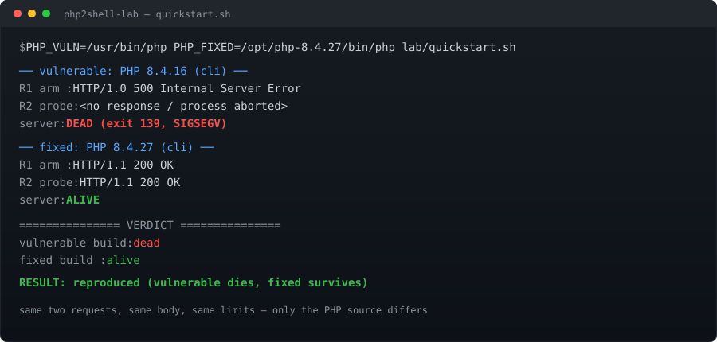

# php2shell-lab

**两个请求就能让 PHP 8.4.26 在你自己的代码跑起来之前崩掉。同样两个请求，打 8.4.27 什么都不会发生。**

针对 `php2shell` 修复（CVE-2026-109618 / CVE-2026-109619）的**差分实验环境**：两个版本都从源码编译，同一套触发，自动判定"崩 / 不崩"——另外附上对当时流传的每一个 "php2shell PoC" 的实测与定性。


[](https://github.com/allureluoli/php2shell-lab/actions/workflows/ab.yml)


**[English → README.md](README.md)**



## 二十秒看懂

`session.upload_progress` 默认开启，而 PHP 在 **RINIT 之前**就解析 multipart body（`php_request_startup() → php_hash_environment()`）。这条路径会解码/编码会话数据。若编码阶段 OOM，8.4.26 会 bailout，把序列化上下文留在"还活着但指向已释放内存"的状态；**同一进程的下一个请求**再次在 RINIT 之前复用它：

```
AddressSanitizer: SEGV on unknown address 0x138 (READ)
 #0 tmp_var                       ext/standard/var_unserializer.c:168
 #2 ps_srlzr_decode_php           ext/session/session.c:1134
 #4 php_session_initialize        session.c:502
 #5 php_session_rfc1867_cleanup   session.c:3211
 #6 php_session_rfc1867_callback  session.c:3375
 #7 rfc1867_post_handler          main/rfc1867.c:1273
#12 php_hash_environment          main/php_variables.c:788
#13 php_request_startup           main/main.c:1873
```

8.4.27（`506e87fa`，*Avoid state corruption via bailout*）把解析期分配改成可失败、延迟 OOM 处理、并在 RINIT 前重置相关全局，于是什么都不留到下一个请求。

## 快速开始 —— 不用编译，约 30 秒

需要两个 PHP CLI：一个 **< 8.4.27**，一个 **>= 8.4.27**。

```bash
git clone https://github.com/allureluoli/php2shell-lab && cd php2shell-lab

PHP_VULN=/usr/bin/php PHP_FIXED=/opt/php-8.4.27/bin/php lab/quickstart.sh
```

```
── vulnerable: PHP 8.4.16 (cli) ──
   R1 arm  : HTTP/1.0 500 Internal Server Error
   R2 probe: <no response / process aborted>
   server: DEAD (exit 139, SIGSEGV)
── fixed: PHP 8.4.27 (cli) ──
   R1 arm  : HTTP/1.1 200 OK
   R2 probe: HTTP/1.1 200 OK
   server: ALIVE

=============== VERDICT ===============
vulnerable build: dead
fixed build     : alive
RESULT: reproduced (vulnerable dies, fixed survives)
```

差分本身**不需要 ASAN** —— 漏洞版自己就段错误。ASAN 只是为了拿到可读的报告。

## 严谨路线 —— ASAN，两版编译参数完全一致

```bash
# 依赖（Debian/Kali）：build-essential autoconf bison pkg-config libxml2-dev curl python3
lab/bootstrap.sh     # 按 sha256 下载并编译 8.4.26 + 8.4.27（ASAN）
lab/run-ab.sh        # 各跑 3 次，写 evidence/*.log，只有 3/3 vs 0/3 才返回 0
```

固定的源码：

| 版本 | sha256 |
|---|---|
| php-8.4.26.tar.gz | `c248abaebc4bb777b80968f0760da0da8e989836e896c9ff637b6775d7d37662` |
| php-8.4.27.tar.gz | `5bafed9994c1a49796b25b5f61c22c9183bfe046b6acc7b363842d03c77f972f` |

两版都用 `--enable-debug -fsanitize=address`，configure 参数与扩展（`session`、`filter`、`ctype`）完全一致 —— 两次运行之间唯一的差别就是 PHP 源码。

## 凭什么信这个结果

- **差分，不是单边演示。** 只有"漏洞版崩、修复版不崩"同时成立，脚本才给出正面结论。
- **CI 上从源码重编、重跑。** `differential` 工作流在 `ubuntu-latest` 上编译两版，只有 `3/3 vs 0/3` 才 exit 0，日志作为 artifact 存档 —— 结果不依赖我这台机器。
- **负向对照**写在 [docs/03-validation.md](docs/03-validation.md)：不造大会话 → 两版都不崩；php-fpm → 第一个请求就把 worker 打死，根本没有"下一个请求"；计数器路径的 PoC → 永远没有 ASAN、没有崩溃。
- **流传 PoC 全部真跑过，不是扫一眼。** [docs/02-poc-review.md](docs/02-poc-review.md) 里逐条列了"它声称什么、实际上是什么、在我这儿跑出什么"。

## 流传 PoC 的真实成色

| 材料 | 声称 | 实际 |
|---|---|---|
| `allureluoli/php2shell-…-PoC` | 计数器 UAF → 预认证 RCE | 伪造 fcall 结构 + 别人机器上的硬编码 delta，还要操作者自己喂泄漏地址。无崩溃、无 RCE。 |
| `0x4148/…-lab` | UAF PoC | 老实的"可达性验证器"，README 自己写了不产生崩溃/代码执行。 |
| `ikow/php2shell-poc` | 三条已验证的链 | session 注入 + LFI；`var_destroy` UAF（要有 `unserialize()` 汇点）；serializer 混用（要双 handler + gadget）。全是应用侧前置条件。 |
| `Quackster/php2shell-proof-of-concept` | 两条链 | 同上两条；本机 `2/2 PASS`，但都需要应用侧汇点。 |
| X 上的 hint `filename="\|O:4:\"Evil\":0:{}"` | "真正的 PoC" | 注入确实落进 session 文件，但默认单 handler 永远不会实例化它。 |
| `jackalsyn.com` 的纠正版 | 泄露工具 + 更正 | 自我更正为"计数器链 DEAD（addref 保活），真实 bug 是 serialize 状态跨请求 UAF，非代码执行"——与本仓库一致。 |

## 常见问题

**这是远程 RCE 吗？** 不是。本仓库复现的是状态损坏导致的崩溃（SEGV / heap-use-after-free），不是命令执行。声称"一个包拿 shell"的人需要拿出命令输出和 reclaim，而不是一份崩溃日志。

**为什么需要预置会话？** arming 请求必须让 `memory_limit` 在 pre-RINIT 解码/编码时被撑爆，所以会话里得先有一个大值。脚本自己写这个文件（`tools/seed_session.py`），因为它是 **lab 侧前置条件**。远程攻击者能否把大值写进自己的会话，取决于目标应用——这一层本仓库没有证明，文档里也明说了。

**为什么不用 php-fpm？** 请求启动失败时 php-fpm/CGI 会结束 worker。这个 bug 需要一个"启动失败后仍然活着、还能接下一个请求"的进程：prefork `mod_php`，或者本仓库用的 CLI 内置服务器。

**为什么是 8M 限制 + 6MB 会话？** 窗口是"解码放得下、编码放不下"。6MB 在限制内，第二份拷贝不在。要调就两个一起调（`MEMLIMIT=… SESSBYTES=…`）。

**关掉 `session.upload_progress.enabled=0` 就好了吗？** 这条路会关掉（PHP 官方仍要求打补丁）。这是实测行为，不是厂商建议。

**哪些版本受影响？** 8.4.27 / 8.3.36 / 8.2.35 / 8.5.12 之前的都受影响。快速路线在 8.4.16 上验证过。

## 目录

```
lab/quickstart.sh     两个现成 PHP CLI 就能做差分（不用编译）
lab/bootstrap.sh      按 sha256 固定版本，编译 8.4.26 / 8.4.27（ASAN）
lab/run-ab.sh         3 次 A/B 主程序，给出判定与 evidence 日志
lab/www/index.php     中性靶页（漏洞在它运行之前就触发）
tools/seed_session.py lab 侧前置条件（一个大会话值）
tools/trigger.py      R1 arming（OOM）+ R2 probe（复用悬垂上下文）
docs/01-root-cause.md 源码级分析、行号、修复改了什么
docs/02-poc-review.md 上面那张表的完整版
docs/03-validation.md 已记录的 A/B、参数、负向对照
docs/04-faq.md        更长的回答，包括"能不能升级成 RCE"
evidence/             本 README 里那些运行结果的原始日志
```

## 使用范围

防守向研究与补丁验证。所有服务只绑 `127.0.0.1`；载荷是一个长度，不是命令。只在自己的机器上用，不要把触发序列指向第三方系统。

## 许可 / 引用

MIT。写文章引用请见 [CITATION.cff](CITATION.cff)。
